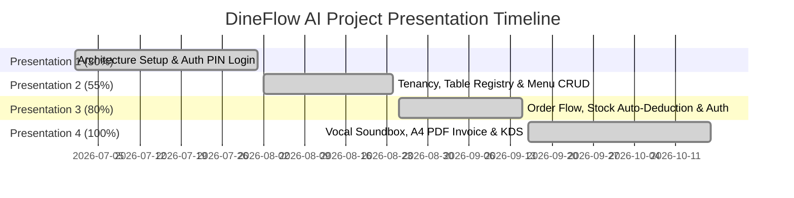

# 🍽️ DineFlow AI POS - Enterprise Restaurant Management System

[](https://laravel.com)
[](https://php.net)
[](https://mysql.com)
[](#)
[](#)

DineFlow AI is a state-of-the-art, enterprise-grade Restaurant POS and Smart Operations Management Platform. Built with Laravel, PHP 8.3, and modern CSS/JS, it empowers restaurants with touchscreen POS billing, live Kitchen Display Systems (KDS), automated stock deduction, vocal soundbox payment announcements, WhatsApp invoices, and executive A4 PDF tax receipts.

---

## 🌟 Key Presentation Highlights & Features

### ⚡ 1. Touchscreen POS Billing Terminal (`/pos`)
- **Quick Order Grid**: Category-filtered menu tiles with instant touch targets.
- **Real-Time Tax Engine**: Auto-calculates Subtotal, 5% Service Charge, 9% CGST, and 9% SGST.
- **Table Registry**: Visual table selection and live order status.

### 📄 2. Executive A4 PDF Tax Invoice & Thermal Receipt Engine (`/orders/{id}/invoice-a4`)
- **Corporate Executive Layout**: Features restaurant branding, GSTIN, table details, and itemized tax breakdowns.
- **Verification QR Code**: Live dynamic QR code linking customers to their digital invoice.
- **Executive Authorized Signatory (SMP)**: Digital verified seal badge with elegant cursive SMP signature.
- **1-Click Printing**: Dual support for A4 PDF Tax Invoices and 80mm Thermal Receipt Printers.

### 📱 3. Smart WhatsApp Invoice Sender
- **1-Click WhatsApp Sharing**: Directly opens WhatsApp with pre-formatted invoice text and digital A4 PDF URL.
- **No Browser Prompts**: Integrated modal UI with live order preview and mobile number input.

### 🔊 4. Vocal Soundbox Payment Announcement Engine
- **Voice Payment Alerts**: Real-time vocal announcements in Gujarati/English when an order payment is marked paid (e.g. *"Table 1, ₹350 Payment Received!"*).
- **Duplicate Suppression**: `localStorage` persistent tracking prevents duplicate voice playback across polls.

### 🍳 5. Kitchen Display System (KDS) & Audio Chimes (`/kitchen`)
- **Live KOT Queue**: Real-time kitchen order monitor updating prep statuses (`Pending` → `Preparing` → `Completed`).
- **Kitchen Pop Chime**: Audio chime notification whenever a new order is received in the kitchen.

### 🛵 6. Live Order Tracker Progress Bar (Domino's / Zomato Style)
- **Customer Order Status**: Visual progress bar tracking order flow:  
  `🟡 Order Received` ➔ `🟠 Cooking in Kitchen` ➔ `🟢 Ready & Serving`.

---

## 👥 Team Members & Module Contributions

| Member Name | Role & Branch | Module Responsibilities |
| :--- | :--- | :--- |
| **Shubh Patel (SMP)** | **Team Lead** (`feature-teamlead`) | Full-Stack Architecture, POS Billing Engine, Soundbox Engine, Thermal Printing, A4 Invoices & WhatsApp Integration |
| **Krushank Dave** | **Member 2** (`feature-krushank`) | Customer Menu UI, Responsive Card Layout & Frontend Data Rendering |
| **Fiyans** | **Member** (`feature-fiyans`) | Table Management UI & Admin Styling Modules |

---

## 📅 Project Presentation Roadmap & Milestones

This section summarizes our backend & full-stack development progress across all 4 key presentation deliverables.



### 🏁 Presentation 1 (Deadline: 01 Aug 2026 | Target: 30%) - **[COMPLETED ✅]**
- **Architecture Setup**: Configured Laravel 11 framework compatible with PHP 8.3.
- **Multi-Auth Engine**: Developed traditional username/password authentication & 4-6 digit touchscreen PIN login.
- **Portable Database**: Configured SQLite & MySQL dual database support for zero-config presentation portability.

### 🏁 Presentation 2 (Deadline: 24 Aug 2026 | Target: 55%) - **[COMPLETED ✅]**
- **Tenancy & Table Registry**: Built multi-tenant Restaurant profiles and Table registry database configurations.
- **Dynamic QR Code Engine**: Implemented TableController to generate live QR URLs linking physical tables to digital menus.
- **Menu Items CRUD**: Created MenuItem models, database schema, and REST API controllers for menu management.

### 🏁 Presentation 3 (Deadline: 15 Sep 2026 | Target: 80%) - **[COMPLETED ✅]**
- **Cart & Order Checkout Flow**: Implemented `POST /api/orders` endpoint supporting complex multi-item cart payloads.
- **Automated Stock Deduction**: Programmed real-time database hooks deducting raw ingredients from `inventories` on checkout.
- **Role-Based Access Control (RBAC)**: Developed `RoleMiddleware` for strict role isolation (`admin`, `manager`, `waiter`, `kitchen`, `customer`).

### 🏁 Presentation 4 (Deadline: 17 Oct 2026 | Target: 100% Final Launch) - **[COMPLETED ✅]**
- **Vocal Soundbox Integration**: Added Gujarati/English vocal announcements for completed payments.
- **Executive A4 PDF Invoice**: Built printable A4 Tax Invoice template with verified SMP signature and QR codes.
- **WhatsApp Billing**: Integrated modal-driven WhatsApp invoice link delivery.
- **KDS Audio Notifications**: Implemented kitchen pop chime alerts for incoming orders.
- **Automated Test Suite**: Passed PHPUnit feature test suite (`RestoPOSTest.php`) with 26 successful assertions.

---

## 🚀 Quick Start Guide

### Prerequisites
- PHP >= 8.3
- Composer >= 2.6
- MySQL or SQLite

### Local Execution
```bash
# Clone the repository
git clone https://github.com/Shubh-Patel-07/DineFlow-AI.git
cd DineFlow-AI

# Install PHP dependencies
composer install

# Run database migrations and seeders
php artisan migrate --seed

# Start Laravel development server
php artisan serve --host=0.0.0.0 --port=8000
```

Access the POS Terminal at: **`http://localhost:8000/pos`**  
Access the Kitchen KDS at: **`http://localhost:8000/kitchen`**

---

## 👤 Demo Accounts & Credentials

| Role | Username | Password | PIN Code | Access Rights |
| :--- | :--- | :--- | :--- | :--- |
| **Admin** | `admin` | `password` | `1234` | Full System Access, Reports & Settings |
| **Manager** | `manager` | `password` | `5678` | Menu Management, Table Control & Stock |
| **Cashier / Staff** | `cashier` | `password` | `9999` | Touchscreen POS, Billing & Invoicing |

---

## 🌳 Git Branching Strategy

Our codebase maintains a clean multi-branch workflow:
- **`main`**: Production-ready, stable release branch.
- **`develop`**: Integration and staging branch for team testing.
- **`feature-teamlead`**: Lead developer feature branch for ongoing enhancements.

---

## 🔌 API Endpoint Reference

### 🔓 Public Endpoints
- `GET /api/restaurants/{id}` - Restaurant metadata
- `GET /api/tables/{id}` - Table details & status
- `GET /api/menu` - Fetch menu items
- `POST /api/orders` - Place customer order (auto-deducts stock)
- `GET /api/orders/{id}` - Order details & line items
- `POST /api/orders/{id}/pay` - Process payment transaction
- `POST /api/waiter-calls` - Dispatch waiter call alert

### 🔐 Protected Back-Office Endpoints (Auth Required)
- `GET /api/orders/restaurant/{restaurantId}` - Fetch active kitchen KOT queue
- `PUT /api/orders/{id}/status` - Update order prep status (`pending` → `preparing` → `completed`)
- `GET /api/tables/restaurant/{restaurantId}` - Fetch live table layouts
- `GET/POST/PUT /api/inventory` - Inventory ingredient stock tracking
- `GET /orders/{id}/invoice-a4` - Render printable A4 Tax Invoice

---

## 📄 License & Attribution

Developed by **Shubh Patel (SMP)** & Team for **DineFlow AI Restaurant Suite**.  
Licensed under the [MIT License](LICENSE).
