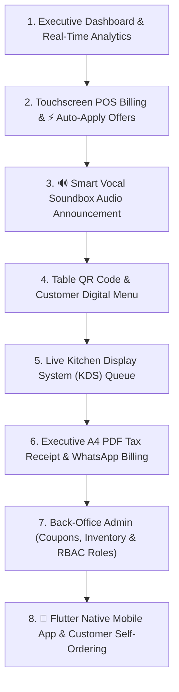

# 🍽️ DineFlow AI POS - Enterprise Restaurant Management System

[](https://laravel.com)
[](https://php.net)
[](https://mysql.com)
[](#)
[](#)

DineFlow AI is a state-of-the-art, enterprise-grade Restaurant POS and Smart Operations Management Platform. Built with Laravel 11, PHP 8.3, and modern CSS/JS, it empowers restaurants with touchscreen POS billing, live Kitchen Display Systems (KDS), automated stock deduction, vocal soundbox payment announcements, WhatsApp invoices, and executive A4 PDF tax receipts.

---

## 🎯 Master Presentation & Demo Guide (First Presentation Flow)

For project demonstrations and evaluators, DineFlow AI is presented as a **100% Complete, Unified, Market-Ready Restaurant Ecosystem** rather than fragmented date-wise modules. Below is the step-by-step recommended presentation flow:



---

### 📊 Step 1: Executive Dashboard (`/dashboard`)
- **Live Sales & Revenue Metrics**: Real-time sales graph, order counts, average order value, and table occupancy rate.
- **Instant Light / Dark Mode Toggle**: 1-click theme switcher presenting ultra-premium visual aesthetics.
- **Hero Quick Action Bar**: Fast navigation to POS, Kitchen KDS, Inventory, and Admin Settings.

---

### 💳 Step 2: Touchscreen POS Billing Terminal (`/pos`)
- **Quick Touch Targets**: Category-filtered menu tiles (Pizza, Beverages, Starters, Main Course).
- **⚡ Smart Auto-Apply Offer Engine**: Selecting a **New Customer** or eligible cart automatically applies the best promo discount (e.g. `⚡ Auto-Applied: WELCOME100 - Saved ₹150`).
- **1-Click Offers Drawer**: Easily view, select, or swap active promotional codes right from the checkout panel.
- **Real-Time Tax Engine**: Automatic calculation of Subtotal, 5% Service Charge, 9% CGST, and 9% SGST.

---

### 🔊 Step 3: Smart Vocal Soundbox Payment Announcement Engine
- **Multi-Language Speech Announcements**: Instant audio payment alerts in **Gujarati**, **Hindi**, or **English** (e.g., *"ડાઇનફ્લો એઆઈ: ટેબલ 1 પરથી ₹500 રૂપિયા પ્રાપ્ત થયા"*).
- **Dynamic Card Labels**: Settings card header title, subtext, and test buttons dynamically adjust to selected language.
- **Duplicate Playback Prevention**: `localStorage` tracking prevents repeated voice alerts during background polling.

---

### 📱 Step 4: Table QR Code Engine & Customer Digital Menu (`/admin/tables` & `/menu`)
- **Table QR Generator**: Instant generation of scannable table-specific QR codes.
- **Customer Mobile Menu**: Contactless ordering directly from customer smartphone browsers.

---

### 🍳 Step 5: Kitchen Display System (KDS) & Order Tracker (`/pos/kitchen`)
- **Live Kitchen Queue**: Real-time order cards updating prep states (`Pending` ➔ `Preparing` ➔ `Ready`).
- **Kitchen Pop Chime**: Audio notification whenever a new order is sent from POS or Customer QR Menu.
- **Progress Bar Order Status**: Visual progress bar tracking order flow (`🟡 Received` ➔ `🟠 Cooking` ➔ `🟢 Ready`).

---

### 📄 Step 6: Executive A4 PDF Tax Invoice & WhatsApp Billing (`/orders/{id}/invoice-a4`)
- **Corporate A4 Layout**: Features restaurant branding, GSTIN, table details, and itemized tax breakdown.
- **Verification QR Code & SMP Seal**: Dynamic QR linking to online invoice + authorized SMP signature badge.
- **1-Click WhatsApp Sharing**: Instantly shares pre-formatted invoice text and PDF receipt link via WhatsApp.

---

### ⚙️ Step 7: Back-Office Admin Management Modules
- **Coupons & Offers (`/admin/coupons`)**: Max discount cap, expiration date/time, usage limits, category restrictions, and auto-apply toggles.
- **Menu Items Manager (`/admin/menu-manager`)**: Add/edit dishes, prices, availability, and category tags.
- **Inventory & Stock Tracking (`/admin/inventory`)**: Stock ingredient management with auto-deduction on checkout.
- **Staff & Role-Based Access (`/admin/staff`)**: Role isolation (`admin`, `manager`, `cashier`, `waiter`, `kitchen`).

---

### 📱 Step 8: Native Flutter Mobile App & PWA Ecosystem (`mobile_app/`)
- **Cross-Platform Flutter Codebase**: Built-in native Android & iOS mobile app codebase under `mobile_app/lib/`.
- **Waiter Mobile POS Grid**: Touchscreen table selector, category dish tiles, and real-time `⚡ Auto-Apply Offers`.
- **Kitchen KDS Mobile Queue**: Mobile kitchen monitor with 1-tap status toggles (`Pending` ➔ `Preparing` ➔ `Ready`).
- **Owner Live Analytics**: Real-time sales dashboard, order count, and top-selling dishes tracking for restaurant owners.
- **Instant PWA Installation**: Integrated `manifest.json` and `sw.js` service worker for 1-click home screen installation on any mobile phone.

---

## 👥 Team Members & Detailed Module Contributions

| Member Name | Role & Git Branch | Technical Contributions & Features Developed |
| :--- | :--- | :--- |
| 👑 **Shubh Patel (SMP)** | **Team Lead**<br>`feature-teamlead` | • **Full-Stack Architecture**: Framework configuration (Laravel 11 + PHP 8.3), REST API routes, Portable dual DB (SQLite/MySQL), and RBAC Middleware.<br>• **Touchscreen POS Terminal (`/pos`)**: Fast billing UI, tax engine (5% Service + 18% GST), table selector, and checkout logic.<br>• **⚡ Auto-Apply Offers Engine (`/admin/coupons`)**: Built 10+ offer features (Max Discount Cap, Expiry, Category & Order Type filters) + POS 1-click & auto-apply coupon logic.<br>• **🔊 Vocal Soundbox Engine**: Multi-language real-time speech announcements (Gujarati, Hindi, English) for paid orders.<br>• **📄 Executive A4 Invoice & Thermal Printer**: A4 Tax Invoice PDF generation with dynamic QR verification, authorized SMP seal signature, and 80mm thermal receipt printing.<br>• **📱 WhatsApp Invoice Sender**: Direct modal integration to share digital invoice links via WhatsApp without browser popups.<br>• **🛢️ Automated Stock Auto-Deduction**: Real-time database triggers deducting raw inventory items upon order checkout. |
| 🧑‍💻 **Krushank Dave** | **Team Member 2**<br>`feature-krushank` | • **Customer QR Digital Menu (`/menu`)**: Contactless mobile ordering UI, responsive dish card layouts, and category filtering.<br>• **🛵 Live Order Status Tracker**: Progress bar tracking order lifecycle (`🟡 Received` ➔ `🟠 Cooking` ➔ `🟢 Ready & Serving`).<br>• **🍳 Kitchen Display System (KDS) UI (`/pos/kitchen`)**: Real-time kitchen order queue cards, audio chime alerts, and status toggles (`Pending` → `Preparing` → `Completed`).<br>• **🛒 Customer Cart & Badge Component**: Interactive floating cart summary, item quantity controls, and cart badge counters. |
| 🧑‍💻 **Fiyans** | **Team Member 3**<br>`feature-fiyans` | • **Table Manager System (`/admin/tables`)**: Table registry UI, occupied status tracking, and dynamic QR Code generation.<br>• **⭐ Reviews & Customer Feedback (`/admin/feedback`)**: Customer ratings storage, review comments list, and star rating analytics.<br>• **🎨 System CSS Design System (`admin.css`)**: Glassmorphism dark/light theme CSS tokens, custom scrollbars, and card shadow system.<br>• **⚙️ System Settings Grid (`/admin/settings`)**: Ultra-modern 6-card preference grid layout for POS & soundbox settings. |
| 🧑‍💻 **Veer Prajapati** | **Team Member 4**<br>`feature-veer` | • **🛒 Interactive Cart System**: Floating cart drawer, item quantity increments, subtotal calculations, and cart item badges.<br>• **🛵 Customer Order Tracking Engine**: Real-time order status progress bar tracking (`🟡 Received` ➔ `🟠 Cooking` ➔ `🟢 Ready & Serving`).<br>• **📱 Mobile Menu Integration**: Responsive customer-facing menu layout optimization for mobile devices. |

---

## 🚀 Quick Start Guide

### Prerequisites
- PHP >= 8.3
- Composer >= 2.6
- MySQL or SQLite

### Local Execution
```bash
# Clone the repository
git clone https://github.com/Shubh-Patel-07/DineFlow-AI.git
cd DineFlow-AI

# Install PHP dependencies
composer install

# Run database migrations and seeders
php artisan migrate --seed

# Start Laravel development server
php artisan serve --host=0.0.0.0 --port=8000
```

Access the POS Terminal at: **`http://localhost:8000/pos`**  
Access the Kitchen KDS at: **`http://localhost:8000/kitchen`**

---

## 👤 Demo Accounts & Credentials

| Role | Username | Password | PIN Code | Access Rights |
| :--- | :--- | :--- | :--- | :--- |
| **Admin** | `admin` | `password` | `1234` | Full System Access, Reports & Settings |
| **Manager** | `manager` | `password` | `5678` | Menu Management, Table Control & Stock |
| **Cashier / Staff** | `cashier` | `password` | `9999` | Touchscreen POS, Billing & Invoicing |

---

## 🌳 Git Branching Strategy

Our codebase maintains a clean multi-branch workflow:
- **`main`**: Production-ready, stable release branch.
- **`develop`**: Integration and staging branch for team testing.
- **`feature-teamlead`**: Lead developer feature branch for ongoing enhancements.

---

## 🔌 API Endpoint Reference

### 🔓 Public Endpoints
- `GET /api/restaurants/{id}` - Restaurant metadata
- `GET /api/tables/{id}` - Table details & status
- `GET /api/menu` - Fetch menu items
- `POST /api/orders` - Place customer order (auto-deducts stock)
- `GET /api/orders/{id}` - Order details & line items
- `POST /api/orders/{id}/pay` - Process payment transaction
- `POST /api/waiter-calls` - Dispatch waiter call alert

### 🔐 Protected Back-Office Endpoints (Auth Required)
- `GET /api/orders/restaurant/{restaurantId}` - Fetch active kitchen KOT queue
- `PUT /api/orders/{id}/status` - Update order prep status (`pending` → `preparing` → `completed`)
- `GET /api/tables/restaurant/{restaurantId}` - Fetch live table layouts
- `GET/POST/PUT /api/inventory` - Inventory ingredient stock tracking
- `GET /orders/{id}/invoice-a4` - Render printable A4 Tax Invoice

---

## 📄 License & Attribution

Developed by **Shubh Patel (SMP)** & Team for **DineFlow AI Restaurant Suite**.  
Licensed under the [MIT License](LICENSE).
