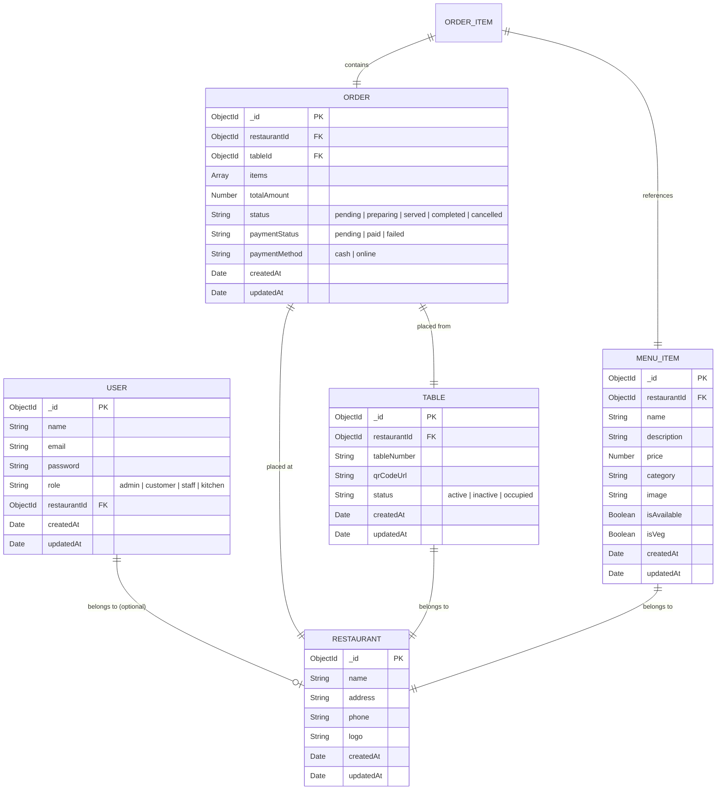

# DineFlow AI - Smart QR Restaurant Ordering System

DineFlow AI is a modern, high-fidelity, QR-code-based restaurant ordering and management system built using the MERN stack (MongoDB, Express, React, Node.js). It offers a seamless customer ordering flow, a kitchen execution panel, a POS administration panel, and real-time status tracking.

---

## 📅 Presentation 1 Timeline Status
* **Target Completion**: 30%
* **Features Completed**:
  - project folder structure (monorepo)
  - database schemas (User, Restaurant, Table, MenuItem, Order)
  - express starter server with Mongoose connection
  - authentication endpoints (Signup & Login APIs)
  - glassmorphism login & signup frontend UI
  - page routing & validation mechanics

---

## 🗃️ Database Schema Design (ER Diagram)



---

## 📂 Project Structure

```
DineFlow AI/
├── client/                  # Frontend Vite React App
│   ├── public/              # Public static assets
│   ├── src/
│   │   ├── assets/          # Static images & graphics
│   │   ├── pages/           # View Pages
│   │   │   ├── Login.jsx    # Login Page React Component
│   │   │   ├── Login.css    # Premium auth style definitions
│   │   │   └── Signup.jsx   # Signup Page React Component
│   │   ├── App.css          # Global Component Layout Styles
│   │   ├── App.jsx          # Front-end routing & component mounting
│   │   ├── index.css        # Theme variables & Design System CSS
│   │   └── main.jsx         # App bootstrapping entry point
│   ├── index.html           # Main HTML shell (Outfit & Inter fonts)
│   ├── package.json         # Client dependencies
│   └── vite.config.js       # Vite configuration
│
└── server/                  # Backend Node.js / Express Server
    ├── config/
    │   └── db.js            # Mongoose MongoDB connection config
    ├── controllers/
    │   └── authController.js# Registration, logging, and token generation
    ├── middleware/
    │   └── authMiddleware.js# JWT Verification Route Guard
    ├── models/              # Mongoose Data Schemas
    │   ├── User.js          # Authentication model
    │   ├── Restaurant.js    # Restaurant details model
    │   ├── Table.js         # Table tracking & status model
    │   ├── MenuItem.js      # Menu categorizations & item details model
    │   └── Order.js         # Placed orders & status logs model
    ├── routes/
    │   └── authRoutes.js    # Signin/Signup routing endpoint declarations
    ├── .env                 # Port, Secrets and Database connection string
    ├── package.json         # Backend core server dependencies
    └── server.js            # Express app setup and middleware routing entry
```

---

## 🛠️ Getting Started & Installation

### Prerequisites
Make sure you have Node.js and MongoDB installed on your system.

### 1. Run the Backend Server
Go to the server directory:
```bash
cd server
```

Install dependencies:
```bash
npm install
```

Ensure MongoDB is running locally, then create a `.env` file inside the `server/` folder:
```env
PORT=5000
MONGO_URI=mongodb://localhost:27017/dineflow
JWT_SECRET=supersecretkey123
NODE_ENV=development
```

Start the backend in developer mode:
```bash
npm run dev
```
The server will boot on `http://localhost:5000`.

### 2. Run the Frontend React App
Navigate to the client directory:
```bash
cd client
```

Install dependencies:
```bash
npm install
```

Start the Vite development web server:
```bash
npm run dev
```
Open `http://localhost:5173` in your browser.

---

## 📋 Git Guidelines for Team Members
- Ensure you work inside your own designated branch:
  - `feature-teamlead`
  - `feature-admin`
  - `feature-fiyans`
  - `feature-krushank`
- Do not make commits directly to `main` or `develop`.
- Pull changes from `develop` frequently to avoid merge conflicts.
